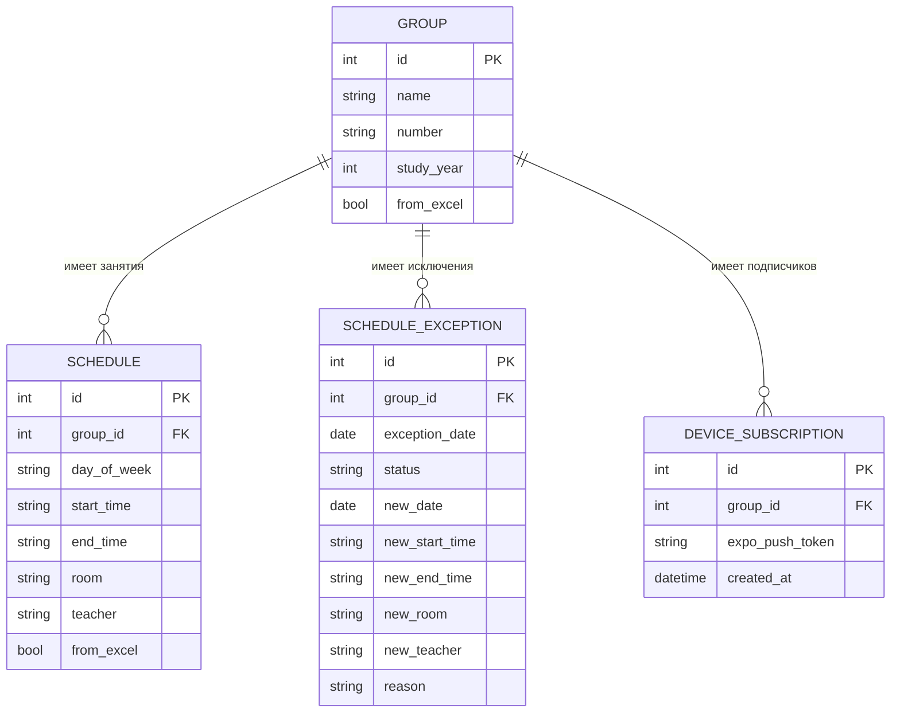

Сервис для просмотра и управления расписанием занятий центра дополнительного образования.
Краткое описание функционала (MVP):
Экран выбора роли: родитель или администратор.
Родитель: выбирает группу, видит её расписание, получает push-уведомления при изменении расписания.
Администратор: изменяет расписание через механизм исключений (отмена/перенос конкретного занятия), что автоматически триггерит push-уведомление родителям этой группы.
Описание технологического стека:
Серверная часть: Python 3.10, FastAPI, SQLAlchemy ORM.
База данных: PostgreSQL 15.
UI: React Native (Expo, managed workflow) — мобильное приложение для Android.
Внешняя зависимость: Expo Push Service — внешний сервис для отправки push-уведомлений. При изменении расписания бэкенд отправляет уведомление через Expo Push API всем подписчикам группы. Мобильное приложение регистрирует устройство и получает Expo Push Token, который сохраняется в базе данных. Expo Push Service самостоятельно доставляет уведомления через FCM (Android).
Инфраструктура: Docker, docker-compose, деплой бэкенда на Render.
Оценка нагрузки: ~10 000 пользователей в сутки, период хранения данных — более 5 лет. Характер нагрузки — read-heavy (большинство операций — чтение расписания).

