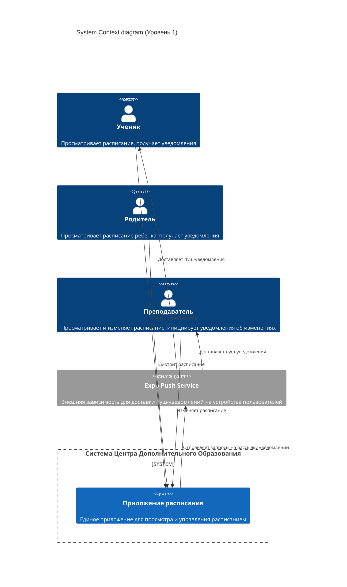
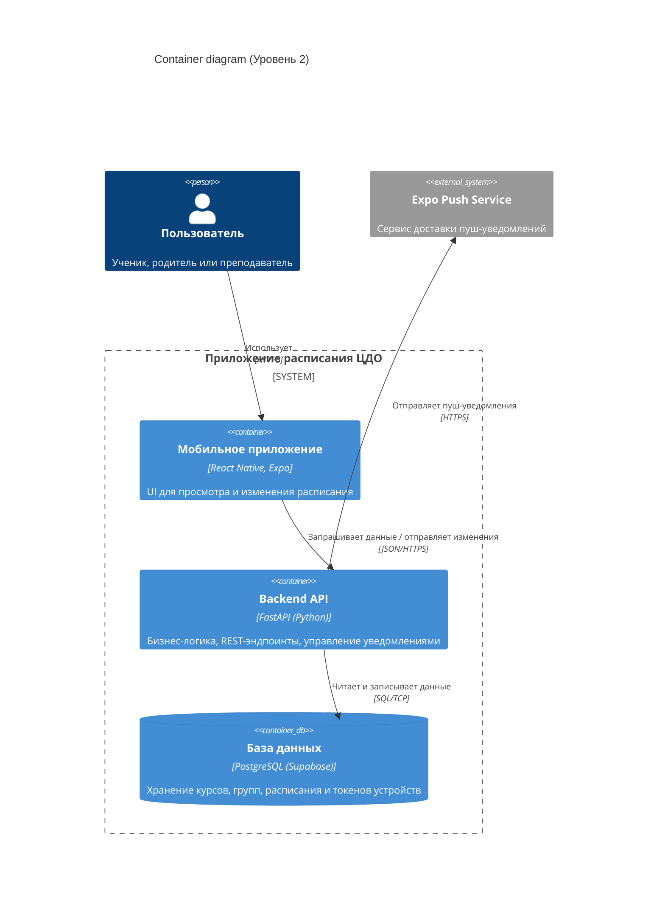
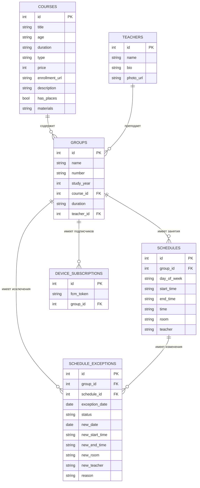

Сервис для просмотра и управления расписанием занятий центра дополнительного образования.
Аверенков Евгений Артемович 5130904/40105
Духанина Алина Дмитриевна 5130904/40105
Хохрякова Дарья Вячеславовна 5130904/40105
Курбыко Алексей Сергеевич 5130904/40105

# Определение проблемы
Ученикам и преподавателям центра дополнительного образования не хватает единого места, где можно посмотреть актуальное расписание и оперативно узнать о его изменениях, а преподавателям — удобно вносить правки в расписание и сразу оповещать затронутых участников. Сейчас информация и изменения ведутся разрозненно, поэтому расписание приходится отслеживать вручную и уточнять друг у друга, что повышает риск пропустить перенос, отмену или новое занятие и создаёт лишнюю нагрузку на преподавателей.

# Выработка требований

# Разработка архитектуры и детальное проектирование

### 1. Характер нагрузки на сервис

**Исходные данные:**
* Пользователи в сутки: ~10 000 (ученики, преподаватели, родители, администраторы).
* Период хранения информации: > 5 лет.
* Профиль нагрузки: read-heavy (преимущественно чтение).

**Соотношение R/W (Read/Write):**
* **Чтение (Read): 95%** — просмотр расписания группы, списка групп, деталей занятия.
* **Запись (Write): 5%** — изменение расписания преподавателем, создание исключения (перенос/дополнительное/отмена), удаление исключений, регистрация push-токена.

**Объёмы трафика:**
* Запросов в сутки: ~35 000 (10 000 пользователей × 3.5 запроса).
* Средний RPS: ~0.4 (35 000 / 86 400).
* Пиковый RPS: ~8–10 (утро с 8:00 до 9:00 и вечер с 18:00 до 20:00).
* Средний размер ответа: ~2 КБ (JSON с расписанием на неделю).
* Трафик в сутки: ~70 МБ.
* Трафик в месяц: ~2 ГБ.

**Объёмы дисковой системы (за 5 лет):**
* Таблица `groups`: ~200 записей по 0.5 КБ (итого 100 КБ).
* Таблица `schedules`: ~600 записей по 0.5 КБ (итого 300 КБ).
* Таблица `schedule_exceptions`: ~5 000 записей по 0.5 КБ (итого 2.5 МБ).
* Таблица `device_subscriptions`: ~10 000 записей по 0.3 КБ (итого 3 МБ).
* Индексы и служебные данные: ~2 МБ.
* **Итого:** ~8 МБ.
*Вывод:* объём данных за 5 лет — менее 10 МБ, что в 50 раз меньше лимита Supabase Free (500 МБ). Запас огромный.

### 2. C4-диаграммы

#### 2.1. System Context diagram (Уровень 1)
Показывает систему в окружении пользователей и внешних сервисов.

### 2.1 2.2. Container diagram (Уровень 2)
Показывает внутреннее устройство системы и технологии.

