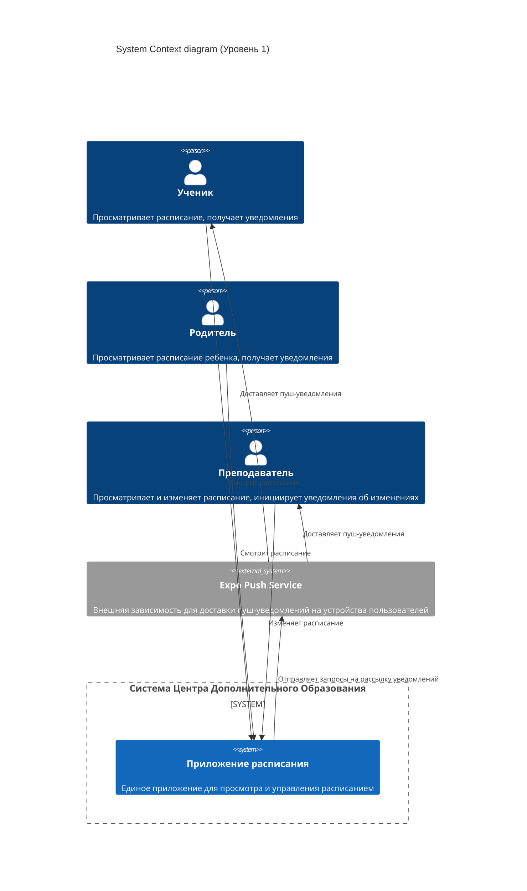
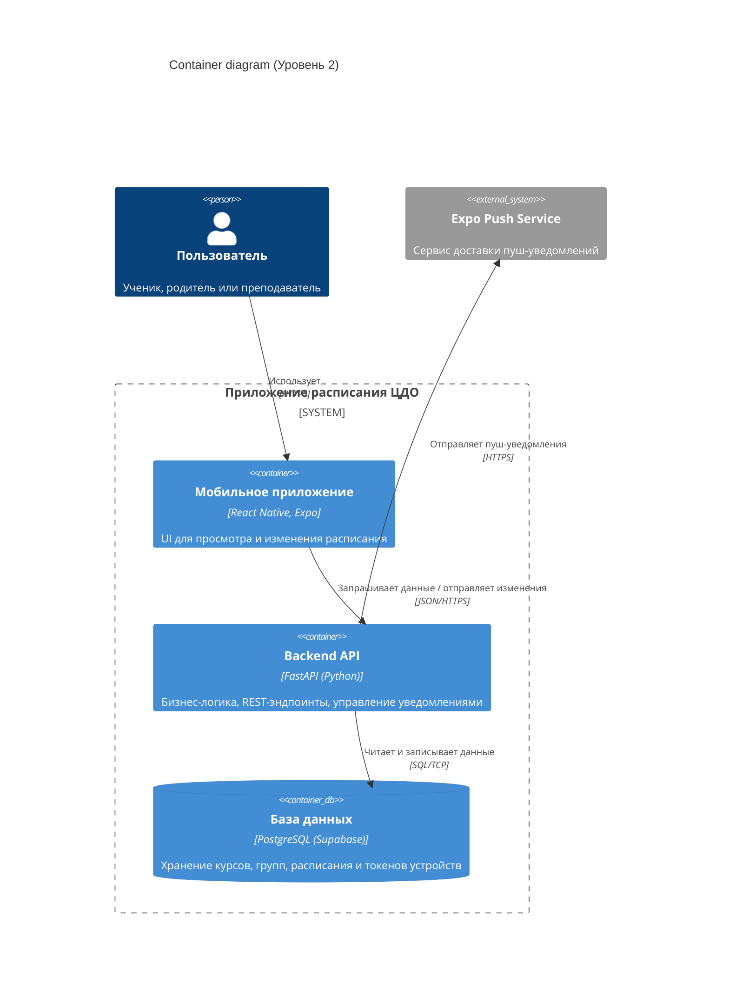
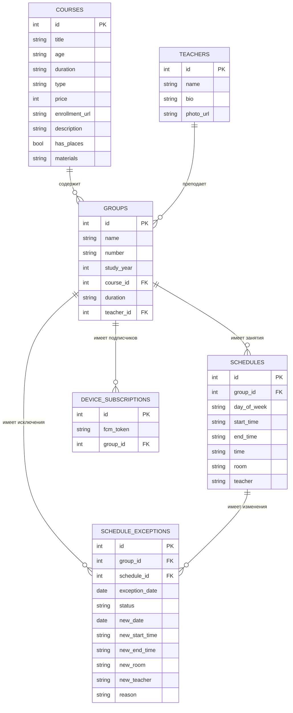
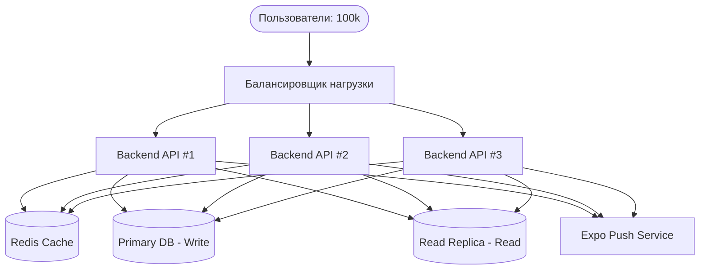

Сервис для просмотра и управления расписанием занятий центра дополнительного образования.
Аверенков Евгений Артемович 5130904/40105
Духанина Алина Дмитриевна 5130904/40105
Хохрякова Дарья Вячеславовна 5130904/40105
Курбыко Алексей Сергеевич 5130904/40105

# Определение проблемы
Ученикам и преподавателям центра дополнительного образования не хватает единого места, где можно посмотреть актуальное расписание и оперативно узнать о его изменениях, а преподавателям — удобно вносить правки в расписание и сразу оповещать затронутых участников. Сейчас информация и изменения ведутся разрозненно, поэтому расписание приходится отслеживать вручную и уточнять друг у друга, что повышает риск пропустить перенос, отмену или новое занятие и создаёт лишнюю нагрузку на преподавателей.

# Выработка требований

## 1. Пользовательские истории

### История 1. Получение расписания и уведомлений
**Как** родитель,
**я хочу** видеть актуальное расписание занятий моего ребенка на текущую и следующую недели, а также получать push-уведомления при отмене, переносе или создании дополнительного занятия,
**чтобы** всегда быть в курсе изменений и не пропустить важные события.

**Сценарий использования:**
1. Родитель регистрируется, добавляет ребенка и выбирает его программы и группы.
2. Приложение запрашивает расписание у бэкенда (`/api/schedule/week`) и отображает его в виде карточек дней недели и занятий.
3. При изменении расписания (отмена/перенос/дополнительное) бэкенд через Expo Push Service отправляет уведомление на устройство.
4. Родитель открывает приложение и видит актуальные данные.

### История 2. Просмотр расписания преподавателем (без пароля — Зритель)

**Как** преподаватель,
**я хочу** видеть только свои занятия на неделю без необходимости вводить пароль,
**чтобы** быстро узнавать своё расписание, не имея прав на его изменение.

**Сценарий использования:**

1. Преподаватель выбирает роль «Учитель», находит себя в списке и нажимает «Сохранить».
2. Поле «Пароль администратора» остаётся пустым.
3. Приложение сохраняет роль `teacher` и флаг `hasAdminRights = false`.
4. Приложение загружает расписание через `/api/schedule/teacher?teacher_name=...`.
5. Преподаватель видит свои занятия на неделю.

### История 3. Управление расписанием (с паролем — Администратор)

**Как** преподаватель с правами администратора,
**я хочу** иметь возможность отменять, переносить занятия и создавать разовые занятия прямо из приложения,
**чтобы** оперативно управлять расписанием.

**Сценарий использования:**

1. Преподаватель выбирает роль «Учитель», находит себя в списке и вводит пароль администратора.
2. Приложение отправляет пароль на `/api/auth/verify-admin`.
3. При успешном ответе сохраняется JWT-токен (`adminToken`) и флаг `hasAdminRights = true`.
4. Приложение загружает расписание через `/api/schedule/teacher?teacher_name=...`.
5. Под карточками занятий отображаются кнопки «Отменить» и «Перенести».
6. В модальном окне «Мои данные» отображаются кнопки «Управление исключениями» и «Разовое занятие».

# Разработка архитектуры и детальное проектирование

### 1. Характер нагрузки на сервис

**Исходные данные:**
* Пользователи в сутки: ~10 000 (ученики, преподаватели, родители, администраторы).
* Период хранения информации: > 5 лет.
* Профиль нагрузки: read-heavy (преимущественно чтение).

**Соотношение R/W (Read/Write):**
* **Чтение (Read): 95%** — просмотр расписания группы, списка групп, деталей занятия.
* **Запись (Write): 5%** — изменение расписания преподавателем, создание исключения (перенос/дополнительное/отмена), удаление исключений, регистрация push-токена.

**Объёмы трафика:**
* Запросов в сутки: ~35 000 (10 000 пользователей × 3.5 запроса).
* Средний RPS: ~0.4 (35 000 / 86 400).
* Пиковый RPS: ~8–10 (утро с 8:00 до 9:00 и вечер с 18:00 до 20:00).
* Средний размер ответа: ~2 КБ (JSON с расписанием на неделю).
* Трафик в сутки: ~70 МБ.
* Трафик в месяц: ~2 ГБ.

**Объёмы дисковой системы (за 5 лет):**
* Таблица `groups`: ~200 записей по 0.5 КБ (итого 100 КБ).
* Таблица `schedules`: ~600 записей по 0.5 КБ (итого 300 КБ).
* Таблица `schedule_exceptions`: ~5 000 записей по 0.5 КБ (итого 2.5 МБ).
* Таблица `device_subscriptions`: ~10 000 записей по 0.3 КБ (итого 3 МБ).
* Индексы и служебные данные: ~2 МБ.
* **Итого:** ~8 МБ.
*Вывод:* объём данных за 5 лет — менее 10 МБ, что в 50 раз меньше лимита Supabase Free (500 МБ). Запас огромный.

### 2. C4-диаграммы

#### 2.1. System Context diagram (Уровень 1)
Показывает систему в окружении пользователей и внешних сервисов.

### 2.2. Container diagram (Уровень 2)
Показывает внутреннее устройство системы и технологии.

### 3. Контракты API и нефункциональные требования

**Эндпоинты для регистрации и выбора группы (Registration):**
* `GET /api/register/programs` — Получить список всех образовательных программ (целевое время: < 200 мс).
* `GET /api/register/programs/{program_name}/study-years` — Получить список учебных годов для конкретной программы (< 200 мс).
* `GET /api/register/programs/{program_name}/study-years/{study_year}/groups` — Получить список групп для программы и учебного года (< 200 мс).

**Аутентификация и права доступа (Auth):**
* `POST /api/auth/verify-admin` — Проверка прав администратора (< 300 мс).

**Управление расписанием и исключениями (Schedule Management):**
* `POST /api/lessons/confirm-action` — Подтвердить действие с занятием (отмена/перенос) (< 500 мс).
* `DELETE /api/exceptions` — Удалить исключение из расписания (< 300 мс).
* `POST /api/one-time` — Создать разовое занятие (< 300 мс).
* `GET /api/recent` — Получить список последних изменений/исключений (< 200 мс).

**Просмотр расписания (Schedule Viewing):**
* `POST /api/schedule/week` — Получить расписание на неделю (< 300 мс).
* `GET /api/schedule/teacher` — Получить расписание для конкретного преподавателя (< 300 мс).

**Уведомления (Notifications):**
* `POST /api/notifications/subscribe` — Зарегистрировать устройство для получения пуш-уведомлений (< 200 мс).

**Справочники (Teachers):**
* `GET /api/teachers/` — Получить список всех преподавателей (< 200 мс).
* `GET /api/teachers/{teacher_id}` — Получить информацию о конкретном преподавателе (< 200 мс).

**Системные (Default):**
* `GET /` — Корневой эндпоинт (Health-check / проверка работоспособности) (< 50 мс).

**Ожидаемые нефункциональные требования (SLA):**
* **Время отклика (p95):** < 500 мс для всех запросов (включая сложные операции записи).
* **Время отклика (p99):** < 1 с (допустимо для холодного старта бесплатных тарифов).
* **Пропускная способность:** ≥ 10 RPS (с запасом покрывает пиковую нагрузку).
* **Доступность:** 99% (на текущем хостинге).

### 3. Контракты API и нефункциональные требования

**Эндпоинты для регистрации и выбора группы (Registration):**
* `GET /api/register/programs` — Получить список всех образовательных программ (целевое время: < 200 мс).
* `GET /api/register/programs/{program_name}/study-years` — Получить список учебных годов для конкретной программы (< 200 мс).
* `GET /api/register/programs/{program_name}/study-years/{study_year}/groups` — Получить список групп для программы и учебного года (< 200 мс).

**Аутентификация и права доступа (Auth):**
* `POST /api/auth/verify-admin` — Проверка прав администратора (< 300 мс).

**Управление расписанием и исключениями (Schedule Management):**
* `POST /api/lessons/confirm-action` — Подтвердить действие с занятием (отмена/перенос) (< 500 мс).
* `DELETE /api/exceptions` — Удалить исключение из расписания (< 300 мс).
* `POST /api/one-time` — Создать разовое занятие (< 300 мс).
* `GET /api/recent` — Получить список последних изменений/исключений (< 200 мс).

**Просмотр расписания (Schedule Viewing):**
* `POST /api/schedule/week` — Получить расписание на неделю (< 300 мс).
* `GET /api/schedule/teacher` — Получить расписание для конкретного преподавателя (< 300 мс).

**Уведомления (Notifications):**
* `POST /api/notifications/subscribe` — Зарегистрировать устройство для получения пуш-уведомлений (< 200 мс).

**Справочники (Teachers):**
* `GET /api/teachers/` — Получить список всех преподавателей (< 200 мс).
* `GET /api/teachers/{teacher_id}` — Получить информацию о конкретном преподавателе (< 200 мс).

**Системные (Default):**
* `GET /` — Корневой эндпоинт (Health-check / проверка работоспособности) (< 50 мс).

**Ожидаемые нефункциональные требования (SLA):**
* **Время отклика (p95):** < 500 мс для всех запросов (включая сложные операции записи).
* **Время отклика (p99):** < 1 с (допустимо для холодного старта бесплатных тарифов).
* **Пропускная способность:** ≥ 10 RPS (с запасом покрывает пиковую нагрузку).
* **Доступность:** 99% (на текущем хостинге).

### 4. Схема базы данных и обоснование нефункциональных требований

Наша схема базы данных спроектирована с учетом профиля нагрузки (read-heavy) и обеспечивает выполнение заявленных нефункциональных требований следующим образом:

* **Быстрое чтение расписания (< 300 мс):** За счет нормализованной структуры связей (FK) и использования ORM (SQLAlchemy) с жадной загрузкой (eager loading) связанных данных, мы избегаем проблемы N+1 запросов при выборке расписания.
* **Быстрый поиск группы (< 200 мс):** Схема позволяет однозначно идентифицировать группу по набору атрибутов (название, номер, учебный год), что минимизирует время на поиск при регистрации.
* **Хранение информации более 5 лет:** За счет использования реляционной структуры и минимального дублирования данных, общий объем базы данных за 5 лет составит около 10 МБ. Это в 50 раз меньше лимита бесплатного тарифа Supabase (500 МБ), что дает огромный запас.
* **Целостность данных:** На уровне БД настроены внешние ключи с правилом `ON DELETE CASCADE` для таблиц `schedules` и `schedule_exceptions`. Это гарантирует, что при удалении группы или занятия не останется «висячих» записей.
* **Оптимизация под Read-heavy профиль:** Денормализация сведена к минимуму, связи осуществляются строго через внешние ключи (FK). При росте нагрузки для дальнейшего ускорения чтения предусмотрено внедрение кэширования (Redis).

### 5. Схема масштабирования сервиса при росте нагрузки в 10 раз

**Что изменится в нагрузке (при росте до 100 000 пользователей):**
* **Средний RPS:** вырастет с 0.4 до 4.
* **Пиковый RPS:** вырастет с ~10 до ~80–100.
* **Трафик в сутки:** вырастет с 70 МБ до 700 МБ.
* **Объём данных за 5 лет:** вырастет с ~10 МБ до ~50–80 МБ.
* **Нагрузка на отправку Push-уведомлений:** вырастет с ~50/мин до ~500/мин.

**Схема масштабирования (архитектура):**

# Кодирование и отладка

Разработка велась параллельно по двум основным направлениям. Каждый участник команды внес свой вклад в проект и сделал коммиты в общий репозиторий.

* **Бэкенд-часть:** **Евгений** и **Алина** занимались разработкой серверной логики на FastAPI, проектированием и настройкой базы данных (PostgreSQL), реализацией REST-эндпоинтов (включая регистрацию, управление расписанием и исключениями), а также интеграцией с сервисом пуш-уведомлений Expo Push Service.
* **Фронтенд-часть:** **Дарья** и **Алексей** отвечали за разработку мобильного приложения на React Native (Expo), верстку пользовательских интерфейсов для учеников и преподавателей, реализацию логики просмотра и изменения расписания, а также обработку входящих пуш-уведомлений на клиенте.

Для отладки использовались стандартные средства логирования фреймворков, интерактивная документация Swagger UI (для тестирования запросов к бэкенду) и инструменты разработчика мобильного приложения (Expo Go).

# Сборка

Проект подготовлен к развертыванию двумя способами: для production-среды и для локального запуска.

* **Production (Облако):** Бэкенд-часть проекта развернута и постоянно работает на облачной платформе Render. В качестве базы данных используется облачный PostgreSQL (Supabase). Мобильное приложение собирается и распространяется через сервис Expo.
* **Локальный запуск (Docker Compose):** Для удобства проверки и локальной разработки бэкенд упакован в Docker-контейнер. В корне репозитория присутствует файл docker-compose.yml, который поднимает серверное приложение и подключает его к облачной базе данных.

**Инструкция по локальному запуску:**
1. Склонировать репозиторий.
2. Настроить переменные окружения (создать файл .env и указать строку подключения к БД и секреты).
3. Выполнить команду `docker compose up --build`.

После сборки бэкенд будет доступен по адресу http://localhost:8000 (с автоматически сгенерированной документацией Swagger по адресу /docs). Использование Docker Compose позволяет развернуть бэкенд-часть проекта на любой машине одной командой без ручной установки зависимостей. База данных при этом является внешней (managed PostgreSQL), что избавляет от необходимости поднимать локальный контейнер с СУБД.
